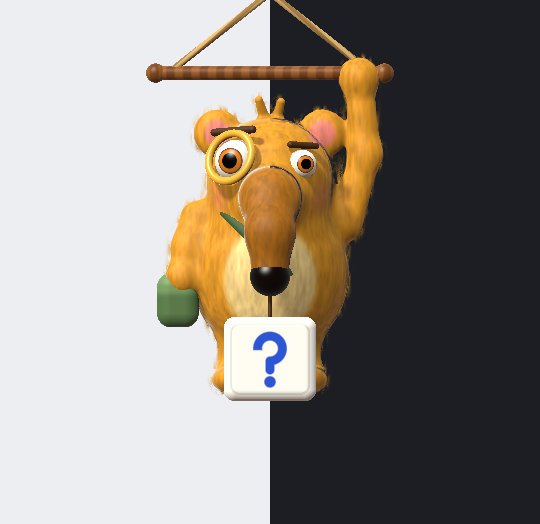

# Hangabouts

*(Working name.)*



**Your agent has been waiting on you for ten minutes. You were in another window.**

Hangabouts fixes that. Odd little creatures live in your macOS menu bar and act out what your AI agents are doing. When Claude Code needs you, **Snuffler** drops down on a rope and hangs there holding a sign until you answer.

This is a **test build**: one species, driven by Claude Code hooks. **Claude Code session?** Read [`CLAUDE.md`](CLAUDE.md) next.

## Why you'd want it

- **No more stalled agents.** A permission prompt in a hidden terminal costs you minutes. Snuffler is hard to miss.
- **No more checking.** Stop flicking back to the terminal "just to see". If he's up in his burrow, the agent is busy.
- **Quiet until it matters.** No sounds, no notification pile. Motion matches urgency, so he only moves when you're needed.
- **One click back.** His card says which session is waiting and for how long. **Go to Claude** or **Go to terminal** takes you there.
- **Not now?** **Hide 10 min** sends him back up.
- **Private.** It listens on `127.0.0.1` only. Nothing leaves your Mac. It never approves or denies a prompt for you.
- **Light.** Native Swift and Metal. No Electron, no web view, no third-party dependencies.
- **He has fur.** And a monocle, and a satchel.

## The core idea

- **Busy:** the creature stays quiet in the menu bar.
- **Needs you:** it drops down, swings, then hangs holding a sign.
- **Done:** a badge on its menu bar icon. Finished work waits for you.
- **Failed:** it looks sheepish and gives a one-line reason. Serious errors get a plain system alert instead.

The rule: motion matches urgency. Only "needs you" and "failed" are allowed to pull your eye.

Built so far: Busy and Needs you. Done and Failed come in Spec 002's last milestone. Each agent type will get its own species.

## Get it

There is no one-click download yet. You build it yourself, which takes about a minute.

You need:

- macOS 14 or later. The app doesn't build anywhere else.
- Swift 5.9 or later. The Xcode Command Line Tools are enough: `xcode-select --install`.
- Claude Code, to send the hook events.

```bash
# Terminal A, repo root
./app/scripts/bundle.sh
open app/build/Hangabouts.app

# Terminal B, repo root
cd sandbox-002 && claude
```

- A burrow icon appears in the menu bar. There is no Dock icon.
- Ask Claude Code for something that needs permission. Snuffler drops down.
- No Claude Code to hand? Click the icon, then **Debug › Simulate Needs you**. **Clear all** sends him back up.

### Use it with your own projects

- `sandbox-002` is a throwaway project that is already wired up.
- For every project: copy the `hooks` block from [`sandbox-002/.claude/settings.json`](sandbox-002/.claude/settings.json) into `~/.claude/settings.json`.
- For one project: copy it into that project's `.claude/settings.json` instead.
- Start a new Claude Code session afterwards. Hooks are read at startup.

Behaviour, milestones and acceptance tests are in [`specs/002-test-hangabout.md`](specs/002-test-hangabout.md).

## Status

| Spec | What | State |
|---|---|---|
| [001](specs/001-hook-reliability.md) | Can Claude Code hooks drive the creatures reliably? | Ready to run |
| [002](specs/002-test-hangabout.md) | The test app: menu bar icon, hook server, Snuffler, card | In progress (M4 of 5 done) |
| [003](specs/003-snuffler-character.md) | Snuffler as a 3D character, with a burrow icon | In progress (built, checks not run) |
| [004](specs/004-snuffler-motion-and-fur.md) | Physics swing, fur, messy burrow, rope | Waiting on a decision |
| [005](specs/005-readme.md) | This README | In progress |
| [006](specs/006-snuffler-metal.md) | Snuffler drawn by Metal, no WebKit, less memory | In progress (built, checks not run) |

Each spec's header holds the detail. Later: answer prompts from the creature's card, and a signed download.

## Run Spec 001

Needs Node 18 or later. No packages to install.

```bash
# Terminal A, repo root
npm run listen

# Terminal B
cd sandbox && claude

# Before each scenario
npm run mark -- A2

# When you're done: paste the output into a copy of results/TEMPLATE.md
npm run analyze
```

Full steps, scenarios and pass criteria are in [`specs/001-hook-reliability.md`](specs/001-hook-reliability.md).

## Repo layout

```
specs/       Test, build and design specs, 001 to 006
harness/     Spec 001: local listener, scenario tagger and analyser (Node 18+, no packages)
sandbox/     Spec 001: throwaway Claude Code project, hooks post to the listener on :7777
sandbox-002/ Spec 002: throwaway Claude Code project, hooks post to the app on :7788
app/         Spec 002: the macOS test app (Swift package, bundled by scripts/bundle.sh)
app-assets/  Menu bar icons
design/      Character notes, explorations and links to design files
results/     Results from each test run
```

`KICKOFF.md` and `KICKOFF-M2.md` are the briefs for milestones already built.

## Privacy

- Two local servers: the Spec 001 listener on port 7777 and the app on port 7788. Both bind to `127.0.0.1` only. Nothing leaves your machine.
- Both answer every hook with `{}`. They never approve or deny a prompt.
- Hook payloads include file paths and tool inputs. The listener writes them to `logs/`, which is git-ignored. Don't commit it.
- The app keeps its own event log at `~/Library/Application Support/Hangabouts/events.jsonl`.
